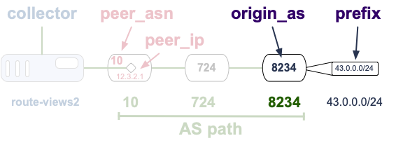

[README](README.md) | [Introduction](Introduction.md) | Datasets ⮕ | [Tasks](Tasks.md) | [Task 1 Guidance](Task-download.md) | [Task 2A Guidance](Task-greedy.md) | [Task 2B Guidance](Task-classify.md) | [Notebook](nids-irr-rpki-whois.ipynb)

# Datasets

This module uses three data sources:

- **IRR database snapshots**
- **RIPE RPKI validated ROA payload archives**
- **Routeviews prefix-to-AS tables**

The notebook reads local copies of these sources and parses them at run time. This page explains where each dataset comes from, what it represents, and what columns you will work with in the assignment.

## Data Access

The notebook reads local files under `data/` and caches parsed results locally under `cache_nids/`. Before running the notebook, follow [Task-download.md](Task-download.md) and run `./download-data.sh` to populate `data/`.

- **IRR snapshots** have no public archive of dated RADB mirror dumps, so CAIDA packaged the snapshots this assignment needs into a single archive (`irr_dumps.zip`), downloaded via `curl` and extracted under `data/irr_dumps/`.
- **RPKI** validated ROA payloads are downloaded from the public RIPE NCC archive (`https://ftp.ripe.net/ripe/rpki/...`) via `curl` and saved under `data/rpki/`.
- **Routeviews prefix-to-AS** is downloaded from CAIDA's public data server (`https://publicdata.caida.org/datasets/routing/routeviews-prefix2as/...`) via `curl` and saved under `data/routeviews-prefix2as/`. Only the sample date (2023-03-01) is needed.

The helper functions (`read_bz2_text()`, `read_gzip_text()`) handle the compressed local files automatically, and raise a clear error pointing at `Task-download.md` if a required file is missing.

## Dependencies

The notebook installs one additional library at startup:

- **py-radix**: A prefix trie library that provides `radix.Radix()` objects. The notebook uses `tree.search_covering(prefix)` to find all VRPs or IRR records that cover an observed BGP prefix. Installed automatically via `%pip install py-radix`.

## IRR Database Snapshots

The Internet Routing Registry (IRR) is not a single database. It is a collection of routing-policy databases operated by Regional Internet Registries (RIRs), commercial networks, non-profit organizations, and other routing registries.

Examples of IRR database providers include:

| IRR source  | operator type                        | notes                                               |
| ----------- | ------------------------------------ | --------------------------------------------------- |
| radb        | non-RIR / Merit Network              | one of the largest non-authoritative IRR databases  |
| arin        | RIR-operated                         | authoritative for ARIN resources                    |
| bboi        | commercial network                   | BBOI (Bangladesh) routing registry                  |
| bell        | commercial network                   | Bell Canada routing registry                        |
| canarie     | national research network            | Canadian research and education network             |
| host        | independent IRR database             | host.net routing registry                           |
| jpirr       | national / regional routing registry | routing registry associated with Japan              |
| level3      | commercial network                   | mainly for Level3/Lumen customers                   |
| nestegg     | independent IRR database             | smaller independent registry                        |
| nttcom      | commercial network                   | mainly for NTT customers                            |
| openface    | independent IRR database             | free to use                                         |
| panix       | independent ISP                      | PANIX (Public Access Networks) routing registry     |
| altdb       | independent IRR database             | free, community-maintained alternate database       |
| reach       | commercial network                   | Reach Networks (Asia-Pacific)                       |
| rgnet       | independent IRR database             | smaller independent registry                        |
| tc          | independent IRR database             | TC Communications routing registry                  |

IRR availability changes over time. Some databases have been retired or removed from common IRR mirror collections. The notebook uses the 16 sources listed above, identified by their lowercase source names as they appear in the `source` column of the loaded IRR data.

### IRR object types

The raw IRR databases contain many RPSL object types. The most common ones are:

| object type | purpose                                          |
| ----------- | ------------------------------------------------ |
| `route`     | maps an IPv4 prefix to an origin AS              |
| `route6`    | maps an IPv6 prefix to an origin AS              |
| `aut-num`   | describes an AS and its routing policy           |
| `as-set`    | groups ASes or other AS sets                     |
| `mntner`    | stores maintainer and authentication information |

The raw IRR snapshot files are WHOIS-format RPSL databases, one gzip-compressed file per source per day. `download-data.sh` downloads `irr_dumps.zip` from `https://users.caida.org/~bhuffake/nids/irr_dumps.zip` and extracts it, producing:

```text
data/irr_dumps/<YYYY-MM-DD>/ftp.radb.net/radb/dbase/<source>.db.gz
```

Note: there is no 2023-04-01 snapshot in the IRR archive, so the April monthly snapshot used in Task 3 is dated **2023-04-03** instead (see `MONTHLY_SNAPSHOT_DATES` in the notebook).

If a required date is missing from the archive, see [Task-download.md](Task-download.md) for how to back-fill it with `copy.py`.

Each blank-line-separated block describes one RPSL object. The notebook's `parse_irr_file()` function extracts the `route:`/`route6:` and `origin:` lines from each `route` and `route6` object; all other RPSL object types and fields are ignored.

After parsing, `load_irr_snapshot()` returns one row per IRR route object with these columns:

| field    | example           | description                                          |
| -------- | ----------------- | ---------------------------------------------------- |
| `source` | `radb`            | IRR database the object came from (lowercase)        |
| `prefix` | `35.228.224.0/19` | prefix in CIDR notation (normalized)                 |
| `origin` | `15169`           | origin AS as an integer (the `AS` prefix removed)    |
| `family` | `4`               | IP address family: `4` for `route`, `6` for `route6` |
| `date`   | `2023-03-01`      | snapshot date the rows were loaded for               |

#### Helpful hint

In the raw RPSL data the `origin` field usually includes the `AS` prefix (e.g. `AS15169`). `parse_irr_file()` normalizes it to the integer `15169` for you, so the loaded `origin` column is ready to join with BGP or RPKI data:

```text
AS15169 -> 15169
```

## RIPE RPKI Archives

RPKI data is rooted in five RPKI trust anchors, one operated by each RIR:

| trust anchor | RIR      |
| ------------ | -------- |
| `arin`       | ARIN     |
| `ripencc`    | RIPE NCC |
| `apnic`      | APNIC    |
| `lacnic`     | LACNIC   |
| `afrinic`    | AFRINIC  |

Note: the notebook uses `ripencc` (not `ripe`) as the identifier for the RIPE NCC trust anchor. When matching trust anchor names between this table and loaded data column values, use `ripencc`.

RIPE NCC publishes historical validated ROA payload data. These archives contain validated outputs from all five trust anchors, not only RIPE NCC resources.

For each day, `download-data.sh` downloads one validated-ROA-payload (VRP) file per trust anchor from the public RIPE NCC archive:

```text
https://ftp.ripe.net/ripe/rpki/<ta>.tal/<YYYY>/<MM>/<DD>/roas.csv.xz
```

and stores it locally at:

```text
data/rpki/<ta>.tal/<YYYY>/<MM>/<DD>/roas.csv.xz
```

where `<ta>` is one of `afrinic`, `ripencc`, `arin`, `lacnic`, `apnic`. After parsing and normalizing the RIPE CSV columns, `load_rpki_snapshot()` returns one row per VRP with these columns:

| field          | example          | description                               |
| -------------- | ---------------- | ----------------------------------------- |
| `prefix`       | `137.110.0.0/16` | prefix authorized by the ROA (normalized) |
| `max_length`   | `20`             | maximum prefix length allowed             |
| `asn`          | `7377`           | AS authorized to originate the prefix     |
| `trust_anchor` | `arin`           | RPKI trust anchor that validated the VRP  |
| `family`       | `4`              | IP address family (`4` or `6`)            |
| `date`         | `2023-03-01`     | snapshot date the rows were loaded for    |

Example rows:

```csv
prefix,max_length,asn,trust_anchor,family
137.110.0.0/16,20,7377,arin,4
35.228.224.0/19,19,15169,ripencc,4
192.0.64.0/18,18,2635,arin,4
```

#### Helpful hint

The `trust_anchor` field identifies the RPKI trust anchor that validated the ROA payload. It is useful for grouping VRPs by RIR trust anchor, but RPKI validation itself depends on prefix coverage, origin AS, and maximum length.

## Routeviews Prefix-to-AS Data (prefix2as)



The Routeviews prefix-to-AS dataset provides a compact snapshot of observed BGP prefix-origin mappings. For more reading on Routeviews BGP data refer to [Understanding the BGP Control Plane](https://github.com/CAIDA/nids-bgp-control-plane).

The notebook only needs the sample date (2023-03-01) for this dataset. `download-data.sh` downloads the corresponding Routeviews `rv2` prefix-to-AS file from CAIDA's public data server:

```text
https://publicdata.caida.org/datasets/routing/routeviews-prefix2as/<YYYY>/<MM>/routeviews-rv2-<YYYYMMDD>-1200.pfx2as.gz
```

and stores it locally at:

```text
data/routeviews-prefix2as/<YYYY>/<MM>/routeviews-rv2-<YYYYMMDD>-1200.pfx2as.gz
```

Each non-comment row is tab-separated:

| position | field         | example        | description        |
| -------- | ------------- | -------------- | ------------------ |
| 1        | network       | `35.228.224.0` | network address    |
| 2        | prefix_length | `19`           | prefix length      |
| 3        | origin_as     | `15169`        | observed origin AS |

Example rows:

```text
1.0.0.0	24	13335
1.0.4.0	22	38803
35.228.224.0	19	15169
137.110.0.0	16	7377
192.0.64.0	18	2635
```

To convert a row into CIDR notation, combine the first two fields:

```text
35.228.224.0 + 19 -> 35.228.224.0/19
```

### Multiple-origin rows

Some prefix-to-AS rows may contain multiple origin ASes.

Example:

```text
203.0.113.0	24	64500_64501
```

For this assignment, treat each origin AS as a separate BGP prefix-origin pair:

```text
203.0.113.0/24,64500
203.0.113.0/24,64501
```

`load_prefix2as_snapshot()` returns one row per BGP prefix-origin pair with columns `prefix`, `origin`, and `date`, after expanding multi-origin rows and removing duplicates.

## Caching

The notebook caches parsed per-day files under `cache_nids/` in the working directory. Once a day's data has been fetched and parsed, subsequent runs skip the download. If a long-running cell is interrupted and restarted, already-cached days are not re-fetched. The cache is safe to delete if you want to force a fresh download.

[README](README.md) | [Introduction](Introduction.md) | Datasets ⮕ | [Tasks](Tasks.md) | [Task 1 Guidance](Task-download.md) | [Task 2A Guidance](Task-greedy.md) | [Task 2B Guidance](Task-classify.md) | [Notebook](nids-irr-rpki-whois.ipynb)
